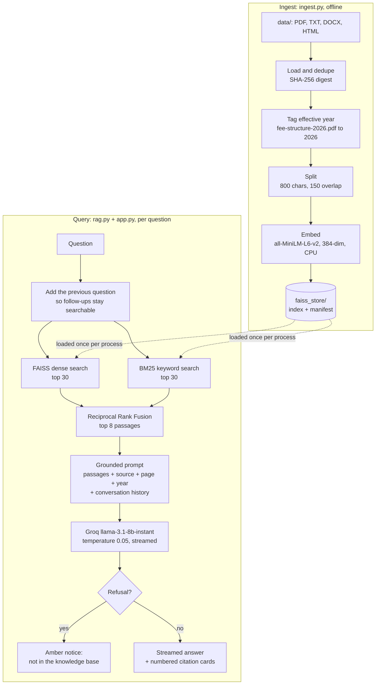

# CollegeBot


**A grounded question-answering assistant for Thapar Institute of Engineering and Technology.** It answers questions about admissions, fees, hostels, courses, scholarships, placements and campus policy **only** from a corpus of source documents, cites the document, page and year it used, and **declines when the answer is not there**.

It runs entirely on free infrastructure: FAISS and BM25 for search, Hugging Face sentence-transformers for embeddings, Groq Cloud for inference and Streamlit for the interface.

> **Why grounding matters, in one example.** An earlier version indexed a synthetic test handbook by mistake. Asked *"What are the library opening hours?"*, it confidently answered "Monday to Saturday, 8:00 AM to 8:00 PM", a fact that existed nowhere in reality. After the fixture was removed and the corpus rebuilt, the same question returns *"open 24 hours a day, on all 365 days of the year"*, with a citation to the source.

---

## At a glance

| | |
|:--|:--|
| **Corpus** | 2,185 chunks from 24 documents: 16 institutional PDFs and 8 researched reference documents |
| **Retrieval** | Hybrid dense + BM25 search fused with Reciprocal Rank Fusion, top 8 passages |
| **Retrieval quality** | The key fact reaches the model's context for **88.6%** of answerable questions, up from 77.1% with dense search alone |
| **Answering** | Groq `llama-3.1-8b-instant`, streamed, with numbered citation cards |
| **Refusals** | Out-of-corpus questions get a distinct "not in the knowledge base" notice, never a guess |
| **Evaluation** | 39-question gold set over the real corpus: refusal accuracy **0.87 to 0.97**, fact recall **0.74 to 0.77** (targets 0.95 and 0.85, not yet met) |
| **Engineering** | 64 offline tests, ruff lint and format, GitHub Actions CI on every push |
| **Fine-tuning** | QLoRA pipeline for Phi-3-mini and Mistral-7B, built and tested; the training run itself is still to be executed |

## What makes it different

- **It never claims something it did not do.** The status pill reflects a real health check, the model chip names the model that actually answered, refusals look like refusals, and heuristic scores are labelled as heuristics.
- **Retrieval was chosen by measurement.** Nine configurations were compared on the same questions. Hybrid search tied the best cross-encoder reranker at zero added latency, and adding the reranker on top made it worse.
- **Evaluation is reported honestly.** The harness is committed, its results are committed, and the README states plainly that neither target is met yet, including the run-to-run noise that makes some improvements unprovable.
- **Sessions are isolated.** Only stateless objects (the embedding model and the indexes) are shared between visitors; conversations live in each visitor's own session.

---

## Quick start

You need Python 3.9 or newer (3.11 recommended) and a free [Groq API key](https://console.groq.com/keys) (no credit card).

```bash
git clone https://github.com/Techy-A/collegebot-rag.git
cd collegebot-rag
python3 -m venv venv && source venv/bin/activate      # Windows: venv\Scripts\activate
pip install -r requirements.txt
cp .env.example .env                                  # then set GROQ_API_KEY in .env
python ingest.py                                      # builds faiss_store/ in about a minute
streamlit run app.py                                  # opens http://localhost:8501
```

`.env` is git-ignored; never commit it. No documents of your own? `python ingest.py --sample` writes a small synthetic handbook so the pipeline can be tested immediately.

**Try it** with questions the corpus covers:

- *"What is the B.Tech tuition fee?"*
- *"How many hostels are there and what do they cost?"*
- *"What was the average placement package?"*

Then ask something it should refuse, such as *"What is the B.Tech fee at IIT Delhi?"*. The refusal appears as an amber notice, never as an answer.

<details>
<summary><b>Other commands</b></summary>

```bash
pytest tests/ -q                                  # 64 tests, no API key or index needed
python evaluation/ragas_eval.py                   # grounding checks on the real corpus
python evaluation/ragas_eval.py --ragas --limit 8 # adds LLM-judged RAGAS on a subset
python evaluation/ragas_eval.py --multi-turn      # follow-up conversation scenarios
python generate_dataset.py --mode curated         # builds the QLoRA training set
ruff check . && ruff format --check .             # lint
```

</details>

<details>
<summary><b>Troubleshooting</b></summary>

| Symptom | Cause and fix |
|:--|:--|
| `No FAISS store found at './faiss_store'` | Run `python ingest.py` |
| Sidebar shows **Unavailable**, "No LLM backend configured" | `GROQ_API_KEY` is missing from `.env` |
| *"Too many questions per minute"* notice | Groq's free tier allows 6,000 tokens per minute. It refills in under a minute; nothing is broken |
| First answer is slow | The embedding model and index load once per session |
| `Port 8501 is already in use` | `pkill -f "streamlit run app.py"`, then start again |
| Fine-tuned models missing from the dropdown | Correct behaviour: they only appear when an endpoint is configured. See [Fine-tuning](#fine-tuning-qlora) |

</details>

---

## How it works



**One request, in one line:** question, plus the previous question, goes to dense and keyword search, the results are fused and the top 8 passages go into a grounded prompt, and Groq streams back an answer with citations, or a styled refusal.

**What is shared and what is not:** `st.cache_resource` holds only the embedding model, the FAISS index and the BM25 index. These are stateless, so they are safe to share across every visitor. Conversation state lives in `st.session_state`, one per visitor.

---

## Retrieval, measured rather than assumed

Every configuration was scored on one question: *does the key fact reach the context at all?* The test uses the 35 answerable gold questions and makes no LLM calls, so it is fast, free and deterministic.

| Configuration | Fact reaches context | Added latency |
|:--|:--|:--|
| Dense MMR, k=6 (previous default) | 77.1% | none |
| Dense similarity, k=6 | 68.6% | none |
| BM25 only, k=8 | 80.0% | none |
| Dense MMR, k=8 | 80.0% | none |
| Dense + cross-encoder reranker, top 6 | 85.7% | ~1.3 s per query |
| Dense + cross-encoder reranker, top 8 | 88.6% | ~2.0 s per query |
| **Hybrid dense + BM25 (RRF), top 8** | **88.6%** | **none** |
| Hybrid + cross-encoder reranker, top 8 | 85.7% | ~1.4 s per query |
| Hybrid, top 16 | 91.4% | none, but twice the context tokens |

Keyword search earns its place because this corpus is full of proper nouns, exact amounts and list headings ("TOP RECRUITERS", "Rs 17,24,000", "A++"), where lexical matching beats a 384-dimensional embedding. Top 8 was kept over top 16 because the extra 2.8 points is not worth doubling the context on a rate-limited free tier. Reranking stays available with `USE_RERANKER=1`.

---

## Evaluation

`evaluation/ragas_eval.py` runs the gold set against the **real** indexed corpus, importing the exact prompt and retrieval settings the app serves, so the two cannot drift apart.

**Layer 1: grounding checks** (deterministic, no API calls, always runs)

- **Refusal accuracy:** did it decline exactly when it should have? A false refusal on an in-corpus question counts as a failure and is reported by name.
- **Fact recall:** do the answers contain the key figures from the source document?

**Layer 2: RAGAS** (opt-in with `--ragas`). Faithfulness, answer relevance and context precision, judged by `llama-3.3-70b-versatile`. The judge is a stronger model than the one being tested, because a model grading its own output tends to favour it. Correct refusals are excluded from RAGAS averages, since an honest "I don't know" scores near zero on faithfulness and would hide real generation quality.

| Round | Change | Refusal accuracy (target 0.95) | Fact recall (target 0.85) |
|:--|:--|:--|:--|
| 1 | Baseline: dense MMR, k=6, new gold set | 0.923 | 0.571 |
| 2 | + hybrid dense and BM25 retrieval | 0.974 | 0.714 |
| 3 | + source year in context, exact-figure prompt rules | 0.974 | 0.771 |
| 4 | + archived the stale 2018 and annual-report PDFs | 0.872 | 0.714 |
| 5 | **Reverted to the round 3 setup (what ships)** | **0.872** | **0.743** |

**How to read this table.** Rounds 3 and 5 ran the same setup and scored 0.974 and 0.872 on refusal accuracy, so run-to-run noise at temperature 0.05 is about 0.10. That is larger than some of the improvements being measured. The hybrid-retrieval gain is real, because the deterministic retrieval test above confirms it (77.1% to 88.6%). The prompt change in round 3 is within the noise. The harness now runs at temperature 0.0, so future comparisons are reproducible.

**What still fails, and why.** The remaining misses share one cause: large, older documents sometimes outrank current ones. Asked for the NAAC grade, the model can quote "A" from a 2018 self-study report instead of today's A++. The next measured change is per-document authority weighting at retrieval time. The full analysis is in [SUMMARY_REPORT.md](SUMMARY_REPORT.md).

---

## Design decisions

<details>
<summary><b>The LLM factory's honesty contract</b></summary>

`available_models()` returns only backends that can actually be served. Groq appears when `GROQ_API_KEY` is set; a fine-tuned model appears only when its Inference Endpoint URL **and** `HF_TOKEN` are both configured. `get_llm()` raises an error rather than quietly substituting a different model.

This replaces an earlier design that advertised three models, silently fell back to Groq when the two fine-tuned ones could not load, and kept showing a "Phi-3-mini (fine-tuned)" badge over a Groq answer.

</details>

<details>
<summary><b>Session isolation</b></summary>

`st.cache_resource` is a process-wide singleton in Streamlit. An earlier version built the conversation memory inside the cached function, so concurrent visitors shared one buffer and their conversations could leak into each other's context. The same bug made the temperature slider reload the whole index from disk, and "Clear conversation" evicted the index for every other visitor. Now only stateless objects are cached, and conversation state lives in each session.

</details>

<details>
<summary><b>No ConversationalRetrievalChain</b></summary>

That legacy chain makes an extra LLM call to rewrite every follow-up question before retrieval: two sequential requests per turn on a rate-limited tier, and it does not stream cleanly. Retrieve, prompt, stream is cheaper and streams directly. Follow-ups stay searchable by adding the previous question to the search query, which costs no API call.

</details>

<details>
<summary><b>Document versioning</b></summary>

The corpus holds same-topic documents from different years, such as the 2025 and 2026 fee structures. `ingest.py` tags every chunk with an effective year, `rag.py` puts that year in the context the model sees, and the prompt tells the model to prefer the most recent source and say which year applies. Citations show the year too.

</details>

<details>
<summary><b>Safe rendering</b></summary>

Message bodies render through `st.markdown()` without `unsafe_allow_html`, so neither a question containing `<` nor a PDF chunk containing markup can inject anything into the page.

</details>

---

## Fine-tuning (QLoRA)

<details>
<summary><b>Method, hyperparameters, training data and how to run it</b></summary>

The QLoRA pipeline is **built, verified and ready to execute end to end**: the training
set is authored and validated, the Colab notebook is corrected and compiles, and the
serving path is wired and covered by tests.

**Status of the training run itself:** not yet executed. It needs a CUDA GPU (the
notebook targets a free Colab T4) plus a Google account and a write-scope Hugging Face
token, so it is a one-command step the repository owner runs. Until an endpoint exists the
UI deliberately does not offer a fine-tuned option - see
[the honesty contract](#the-llm-factorys-honesty-contract).

#### How the fine-tuning works

**1. Method - QLoRA.** The base model is loaded in 4-bit NF4 quantization, its weights
frozen, and small low-rank adapter matrices are trained on top. Only the adapters receive
gradients, which is what makes a 7B model trainable in ~15 GB of T4 VRAM. Double
quantization is applied to the quantization constants for a further VRAM saving, and the
same quantization config is used at training and inference time so there is no
quantization mismatch between them.

**2. Hyperparameters** and why each is set that way:

| Parameter | Value | Reason |
|---|---|---|
| LoRA rank `r` | 16 | Enough capacity for domain adaptation without exhausting T4 VRAM |
| LoRA `alpha` | 32 | Conventional 2x scaling relative to rank |
| Base precision | 4-bit NF4 | Halves VRAM against fp16; NF4 suits normally-distributed weights |
| Batch size | 2 (Phi-3) / 1 (Mistral-7B) | The largest that fits; Mistral is the bigger model |
| Gradient accumulation | 4 / 8 | Gives an effective batch of 8 in both cases |
| Learning rate | 2e-4 | Standard for LoRA on instruction data |
| Epochs | 2 | Domain adaptation without overfitting a small set |
| Gradient checkpointing | on | Trades compute for ~30% VRAM |
| Optimizer | 8-bit AdamW | Keeps optimizer state off the VRAM budget |

**3. Training data.** `curated_dataset.py` holds 70 hand-authored pairs - 55 grounded and
15 refusal - written to the same house style the production prompt enforces. Two
decisions matter more than the count:

- **Every record carries its retrieved context.** Records are Alpaca-style
  `{instruction, input, output}` where `input` is the grounding passage. At inference this
  model never answers from memory - it receives retrieved passages and must answer only
  from them - so training must mirror that. A contextless dataset teaches the model to
  answer from parametric memory, which fights the grounding prompt and produces confident
  wrong answers.
- **Refusals are training data.** 21% of records pair a reasonable question with context
  that genuinely does not answer it: another institution's fees, personal student records,
  prompt-injection attempts, subjective judgements, future predictions. A generator that
  derives questions *from* the passage containing the answer cannot produce these, so it
  cannot teach the one behaviour this product depends on.

**4. Prompt format used for training** - deliberately mirrors serving, and terminates with
EOS so the model learns to stop:

```
#### Context:
{retrieved passages}

#### Question:
{student question}

#### Answer:
{grounded answer}<eos>
```

**5. Steps to run it:**

```bash
python generate_dataset.py --mode curated     # writes dataset/train.jsonl + eval.jsonl
```

1. Upload `dataset/` to Google Drive (and your source PDFs, if rebuilding the index there).
2. Open [colab.research.google.com](https://colab.research.google.com), then **Runtime, Change
   runtime type, T4 GPU**.
3. Add `HF_TOKEN` (write scope) and `GROQ_API_KEY` as **Colab Secrets** - the notebook
   reads them via `userdata.get()`, so tokens never sit in a cell.
4. Copy the cells from `notebooks/CollegeBot_Colab.py` and run them in order. Roughly
   60 to 75 min for Phi-3-mini and ~90 min for Mistral-7B.
5. The **adapter is pushed first** (a few MB, seconds) so a session timeout cannot lose
   the run; the merged 16-bit model is pushed after, behind a `PUSH_MERGED` flag.
6. Create a Hugging Face Inference Endpoint for the pushed model, then set
   `PHI3_ENDPOINT_URL` (or `MISTRAL_ENDPOINT_URL`) in `.env`. The option appears in the UI
   automatically - no code change.

**6. Always use `--mode curated`.** The two automatic generators produce data that would
make the model worse; the measured comparison is in
[SUMMARY_REPORT.md](SUMMARY_REPORT.md) (36% of generated answers under 60 characters, 16%
truncated mid-phrase, 0% carrying context, 0 refusal examples).

**7. What fine-tuning will and will not fix.** It buys format adherence, house style and
refusal discipline. It does **not** improve factual grounding - that is a retrieval and
source-authority problem, and the current evaluation gap lives there, not in the model
weights. Treat the fine-tune as a behaviour-shaping step, and keep judging factual quality
with `evaluation/ragas_eval.py`.

</details>

---

## Configuration

Everything is optional except `GROQ_API_KEY`. Set values in `.env` or in Streamlit secrets.

| Variable | Default | Purpose |
|:--|:--|:--|
| `GROQ_API_KEY` | none | **Required.** Free at console.groq.com |
| `FAISS_PATH` | `./faiss_store` | Index location |
| `GROQ_MODEL` | `llama-3.1-8b-instant` | Serving model |
| `JUDGE_MODEL` | `llama-3.3-70b-versatile` | RAGAS judge |
| `RETRIEVAL_K` | `8` | Passages passed to the model |
| `RETRIEVAL_FETCH_K` | `30` | Candidate pool per retriever |
| `USE_HYBRID` | `1` | Dense + BM25 fusion; `0` for dense-only MMR |
| `USE_RERANKER` | off | Cross-encoder reranking |
| `EMBED_MODEL` | `all-MiniLM-L6-v2` | Embedding model |
| `LOG_LEVEL` | `INFO` | Logging level |
| `HF_TOKEN`, `PHI3_ENDPOINT_URL`, `MISTRAL_ENDPOINT_URL` | none | Fine-tuned backends |

## Deploying to Streamlit Community Cloud

1. Commit `faiss_store/`. The index has to ship, because there is no GPU to rebuild it.
2. Point a new Streamlit Cloud app at `app.py`.
3. Under **Secrets**, add:
   ```toml
   GROQ_API_KEY = "gsk_your_key"
   FAISS_PATH   = "./faiss_store"
   ```
4. Free apps sleep after inactivity, so a cold link shows a wake-up screen first.

Never commit `.env` or `.streamlit/secrets.toml`.

---

## Project structure

<details>
<summary><b>Every file and what it does</b></summary>

#### Application

| File | Lines | Role |
|---|---:|---|
| `app.py` | 414 | Streamlit UI **only** - layout, chat rendering, citation cards, refusal/error states. No retrieval logic. |
| `rag.py` | 379 | The pipeline: corpus loading, hybrid retrieval, RRF, prompt assembly, streaming, rate-limit retry, logging. Importable without Streamlit. |
| `prompts.py` | 51 | The grounding prompt and refusal text. Single source of truth for app **and** evaluation, so they cannot drift. |
| `llm_factory.py` | 158 | Backend selection with the honesty contract - only serves what is actually configured. |
| `assets/style.css` | 551 | The premium black theme. |

#### Data pipeline

| File | Lines | Role |
|---|---:|---|
| `ingest.py` | 383 | Documents, dedupe, year tag, chunk, embed, then FAISS + manifest. |
| `data/` | 24 files | 16 institutional PDFs + 8 researched Thapar reference documents (each ending in its source URLs). |
| `faiss_store/` | - | `index.faiss`, `index.pkl`, and `manifest.json` recording build time, embedding model, chunk settings and per-file years. |

#### Evaluation

| File | Lines | Role |
|---|---:|---|
| `evaluation/gold_set.py` | 321 | 39 gold Q&A over the real corpus + 3 multi-turn scenarios. Each item carries `must_include` tokens and an `expect_refusal` flag. |
| `evaluation/ragas_eval.py` | 381 | Two-layer harness. Deterministic grounding checks always run; RAGAS is opt-in. |
| `evaluation/quick_score.py` | 167 | Sub-10 ms keyword heuristics for the optional inline display. Labelled as heuristics in the UI, never as verified metrics. |
| `evaluation/eval_results.json` | - | Committed on purpose: a metric nobody can reproduce is not evidence. |

#### Fine-tuning

| File | Lines | Role |
|---|---:|---|
| `curated_dataset.py` | 435 | Hand-authored training set: 55 grounded pairs + 15 refusal pairs, each carrying its grounding context. |
| `generate_dataset.py` | 448 | Dataset CLI - `--mode curated` (recommended), `--mode groq`, `--mode local`. |
| `notebooks/CollegeBot_Colab.py` | - | QLoRA cells for Phi-3-mini and Mistral-7B on a free Colab T4. |

#### Tests and tooling

| File | Lines | Role |
|---|---:|---|
| `tests/test_rag.py` | 352 | Retrieval, RRF, citations, prompt assembly, streaming, rate-limit retry. |
| `tests/test_factory_and_ingest.py` | 161 | The honesty contract, year tagging, digest dedup, heuristic scorer. |
| `tests/test_dataset_generation.py` | 63 | The Q&A parser, including the multi-line truncation regression. |
| `.github/workflows/ci.yml` | - | ruff lint + format check + pytest on every push. |
| `pyproject.toml` | - | ruff and pytest configuration. |

All 64 tests run offline: no API key, no index, no network.

#### Documentation

| File | Role |
|---|---|
| `README.md` | This file. |
| `SUMMARY_REPORT.md` | What changed and why, with measured before/after numbers and honest limitations. |
| `council-improvements.md` | The multi-perspective review that produced the work plan. |
| `LICENSE` | MIT, plus a note that `data/` is third-party material not covered by it. |

</details>

---

## Known limitations

- **Neither evaluation target is reliably met yet** (see [Evaluation](#evaluation)). The main cause is diagnosed: large older documents sometimes outrank current ones.
- **The free Groq tier sets the throughput ceiling:** 6,000 tokens per minute shared by everyone using a deployment, roughly 2 to 3 questions per minute. The interface explains the wait instead of showing a bare error.
- **Answers are only as current as the documents.** Fees, deadlines and rankings change every year, so verify anything important with the institute directly.
- **Fee tables are chunked as prose,** so a table can split mid-row. Table-aware extraction is the next retrieval improvement to measure.
- **The corpus is trusted.** Instructions and retrieved text are not structurally separated, so do not add unreviewed third-party documents to `data/`.
- **No conversation persistence.** Refreshing the page starts a new session.

## License

MIT, see [LICENSE](LICENSE). The documents under `data/` are third-party institutional material and are **not** covered by that licence.

---

<sub>Built by [Aryan Awasthi](https://github.com/Techy-A). ENC @ Thapar Institute of Engineering and Technology.</sub>
